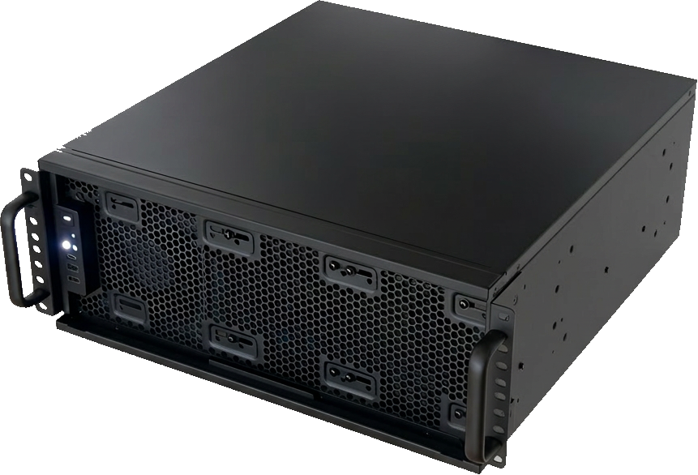
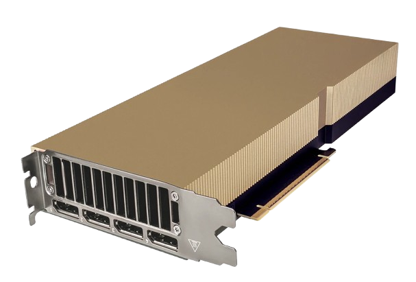

# s2-server

  
  

Everything needed to take the onprem.ai S2 server from buying the parts to a machine
ready for the onprem.ai inference platform install. The platform installs and updates
its own software; this repository covers everything it does not own: the hardware, the
firmware, the operating system, the NVIDIA driver and the container runtime.

| Server | Spec |
|---|---|
| Board, CPU | ASUS ProArt X870E-CREATOR WIFI, AMD Ryzen 9 9900X |
| GPUs | 2x NVIDIA RTX PRO 6000 Blackwell Server Edition (96 GB, passive) |
| Out-of-band | Sipeed NanoKVM-PCIe (open-source KVM); ASUS IPMI Expansion Card-SI as option |
| OS | Rocky Linux 10 or Ubuntu 24.04 |
| Indicative cost (2026-10, without VAT) | ~CHF 39,000 / ~EUR 37,000 / ~USD 42,000, **~90 % of it the two GPUs** ([details and disclaimer](01-bom.md#indicative-cost)) |

## Steps, in order

| Step | Doc | Ends with |
|---|---|---|
| 1 | [01-bom.md](01-bom.md) ([bom.csv](bom.csv)) | Every part ordered |
| 2 | [02-assembly.md](02-assembly.md) | The machine powers on and lists both GPUs and both disks |
| 3 | [03-bring-up.md](03-bring-up.md) | BMC locked down and reachable, BIOS settings and firmware done, BIOS reachable remotely, Secure Boot off |
| 4 | [04-provisioning.md](04-provisioning.md) | OS, pinned kernel and NVIDIA driver, kernel parameters, Docker and the NVIDIA Container Toolkit, GPU fan control, network bond |
| 5 | [05-acceptance.md](05-acceptance.md) | Burn-in and host checks passed, machine recorded, platform installed |
| after | [06-operations.md](06-operations.md) | Planned driver and kernel changes, GPU and disk failures |

This repository is generic: it holds no data about specific machines (rules for
contributors and AI agents: [CLAUDE.md](CLAUDE.md)). Per machine:
[machine-record.md](machine-record.md), an empty template: copy it to the **fleet
repository** (separate, one record per machine) and fill it in there, from step 2 to
step 5.

## Other folders

- `learnings/`: the incident notes the docs cite as evidence.
- [`options/`](options/): optional variants of the standard steps, for example
  [RAID 0 for compute-only nodes](options/raid0-compute-only.md).
- [`hardware/`](hardware/): vendor manuals and datasheets, one folder per component
  (mainboard and BIOS, PSU).

Remote provisioning through the ASUS IPMI card (screen, mouse, keyboard, power, BIOS,
card firmware) for an AI agent: [asus-ipmi-mcp](https://github.com/onprem-ai/asus-ipmi-mcp),
an MCP server in its own repository.
