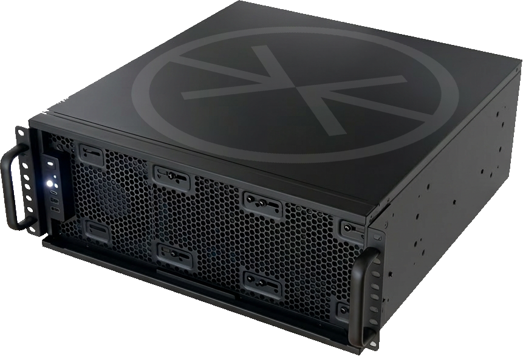
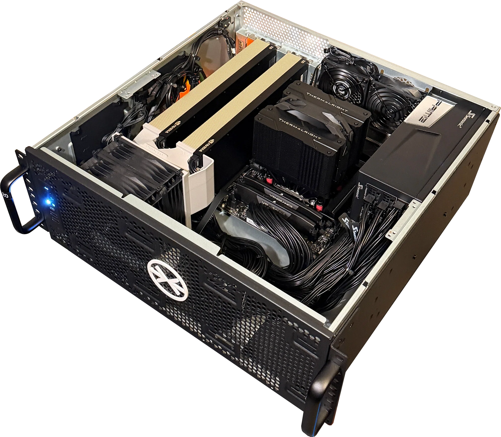
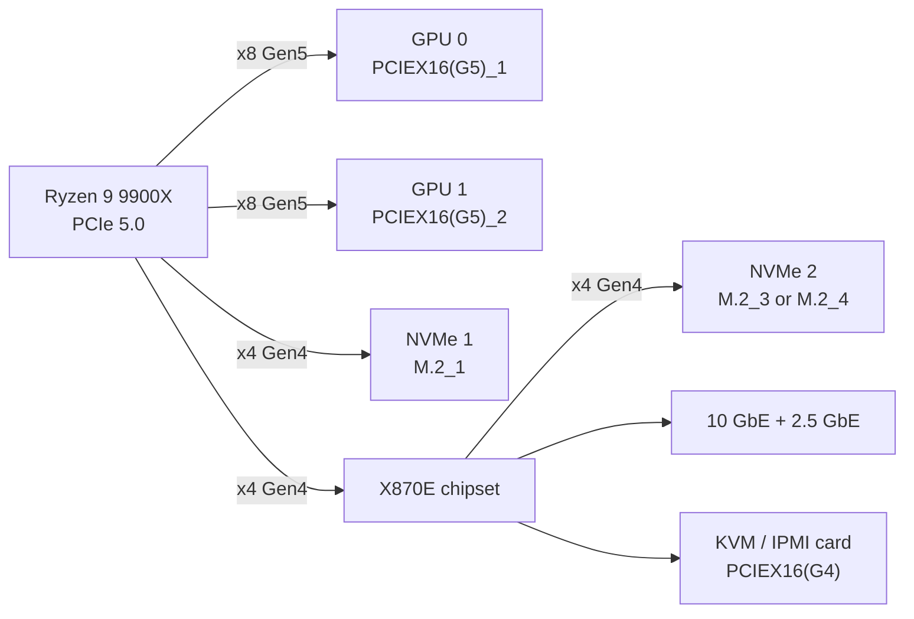

  <picture>
    <source media="(prefers-color-scheme: dark)" srcset="docs/onprem_logo_text_white.svg">
    
  </picture>

<h1 align="center">AI Server S2: Full Technical Specification</h1>

  A GPU inference server with 192 GB of GPU memory in a 4U rack chassis: every part,
  slot, BIOS, firmware and operating system setting specified. Reproducible in every
  step, from buying the parts to a machine ready for the
  <a href="https://onprem.ai">onprem.ai</a> platform: every S2 built to it is the same machine.

  

## Specification

| Component | Specification |
|---|---|
| GPUs | 2x NVIDIA RTX PRO 6000 Blackwell Server Edition, 96 GB each (192 GB) |
| PCIe fabric | PCIe 5.0 x8 per GPU; GPU-to-GPU by direct P2P DMA over the CPU's PCIe root complex |
| GPU power | 600 W, capped at 500 W |
| Board | ASUS ProArt X870E-CREATOR WIFI (AM5, X870E) |
| CPU | AMD Ryzen 9 9900X, 12 cores, PCIe 5.0 |
| RAM | 64 GB DDR5 (2x 32 GB, one module per channel), non-ECC |
| Storage | 2x 2 TB NVMe (PCIe 4.0 x4), Linux software RAID 1 (`mdadm`) |
| Network | 10GBASE-T (Marvell AQC113) and 2.5GBASE-T (Intel I226-V), RJ45 on board, active-backup bond |
| Out-of-band | Sipeed NanoKVM-PCIe (KVM over IP, virtual media, power control); ASUS IPMI Expansion Card-SI as option |
| Power supply | One Seasonic PRIME PX-2200, 2200 W, 200 to 240 V AC, C20 inlet (C19 cord) |
| Power draw | About 1.3 kW at full load with the GPU power limit |
| Cooling | Front to back: two GPU fans in a duct in front of the GPUs, two 80 mm rear fans, GPU fans controlled from GPU temperature |
| Chassis | SilverStone RM4A, 4U, 440 x 176 x 446 mm (W x H x D), 7.6 kg empty |
| Operating system | Rocky Linux 10 (kernel 6.12) or Ubuntu 24.04 (HWE kernel 6.17), kernel pinned |
| GPU stack | NVIDIA driver 595, open kernel modules; Docker with the NVIDIA Container Toolkit |

Parts and part numbers: [01-bom.md](01-bom.md) ([bom.csv](bom.csv)). Slot and lane
assignment: [slot plan](02-assembly.md#slot-plan).

## Inside the S2

  

## PCIe topology

M.2_2 stays empty: it shares lanes with GPU 1 and drops it to x4.

## Limitations

- **Single power supply.** One 2200 W PSU with headroom for both GPUs at full load.
  Redundancy comes from a second node; a UPS covers a failed power feed.
- **System memory without ECC.** The models live in GPU memory.
- **Remote management through KVM over IP.** Full remote control: screen, keyboard,
  virtual media for OS installs, power and reset, also into the BIOS. Board sensors are
  read by the operating system, not over IPMI or Redfish.

The points above are deliberate choices, based on operating experience and optimal
ratio of compute to price, not gaps. Where redundancy matters, run several S2 nodes:
the onprem.ai platform spreads models over them, and a failed node does not stop the
service.

## Scope

In scope: the hardware, BIOS and firmware, the operating system, the NVIDIA driver and
the container runtime. Out of scope: the onprem.ai inference platform, which installs
and updates its own software on top.

## Build procedure

| Phase | Document | Exit criteria |
|---|---|---|
| 1 | [01-bom.md](01-bom.md) | Every part ordered |
| 2 | [02-assembly.md](02-assembly.md) | The machine powers on and lists both GPUs and both disks |
| 3 | [03-bring-up.md](03-bring-up.md) | Out-of-band access locked down and reachable, BIOS settings and firmware done, Secure Boot off |
| 4 | [04-provisioning.md](04-provisioning.md) | OS, pinned kernel and NVIDIA driver, kernel parameters, Docker and the NVIDIA Container Toolkit, GPU fan control, network bond |
| 5 | [05-acceptance.md](05-acceptance.md) | Burn-in and host checks passed, machine recorded, platform installed |
| Operation | [06-operations.md](06-operations.md) | Planned driver and kernel changes, GPU and disk failures |

## Per machine

This repository is generic: it holds no data about specific machines (rules for
contributors and AI agents: [CLAUDE.md](CLAUDE.md)).
[machine-record.md](machine-record.md) is an empty template: copy it to the **fleet
repository** (separate, one record per machine) and fill it in there, from phase 2 to
phase 5. At handoff the customer gets an
[acceptance certificate](acceptance-certificate.md): every check passed, who
performed it, when.

## Repository layout

- [`scripts/`](scripts/README.md): the Rocky Linux 10 steps of
  [04](04-provisioning.md) and [05](05-acceptance.md) as root scripts, in order.
- [`hardware/`](hardware/): vendor manuals and datasheets, one folder per component.
- [`options/`](options/): optional variants of the standard build, for example
  [RAID 0 for compute-only nodes](options/raid0-compute-only.md).
- [`learnings/`](learnings/): the incident notes the specification cites as evidence.
