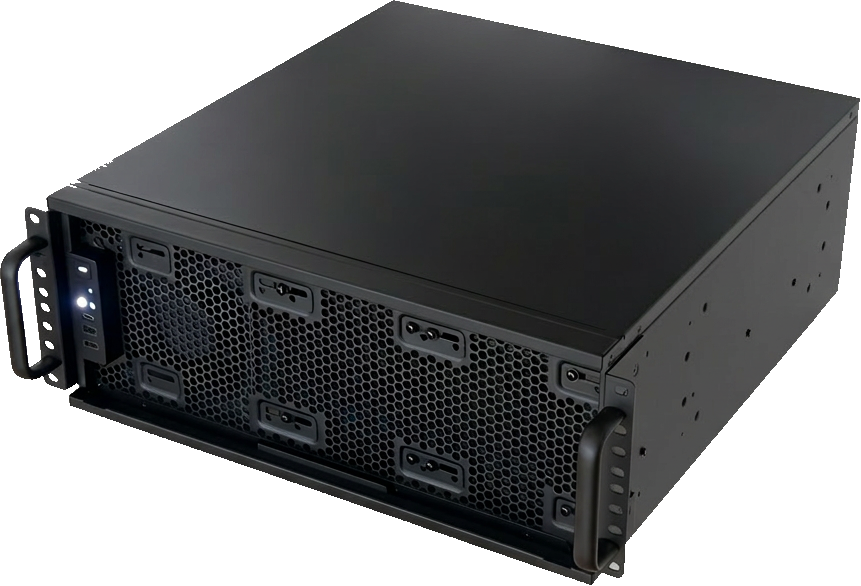

# Chassis: SilverStone RM4A

4U rackmount chassis, model number SST-RM4A.
[Product page](https://www.silverstonetek.com/en/product/info/server-nas/rm4a/).
Downloaded 2026-10-24 from SilverStone.

| File | What | Source |
|---|---|---|
| [SilverStone_RM4A_manual.pdf](SilverStone_RM4A_manual.pdf) | User manual: parts list, expansion card retainer, component limits | [silverstonetek.com](https://www.silverstonetek.com/downloads/Manual/case/Multi-RM4A-Manual.pdf) |
| [server-s2.png](server-s2.png) | Product image of the S2 in the RM4A | supplied by the team, 2026-10-26 |
| [server-s2-logo.png](server-s2-logo.png) | The same image with the onprem.ai logo on the lid; used on the [repository front page](../../README.md) | supplied by the team, 2026-11-13 |
| [server-s2-interior.webp](server-s2-interior.webp) | The S2 open, from the front: GPU fan duct and both GPUs, CPU cooler, rear fans, PSU | supplied by the team, 2026-11-13 |
| [SilverStone_RM4A_product_sheet_EN.pdf](SilverStone_RM4A_product_sheet_EN.pdf) | Product sheet | [silverstonetek.com](https://www.silverstonetek.com/upload/sstedm/rm4a/RM4A-ProductSheetEN.pdf) |

## Key facts for the S2

| Item | Limit or value | S2 part | Fits |
|---|---|---|---|
| Graphics card length | 424 mm (front fans and radiator count against it) | RTX PRO 6000 Server Edition, 267 mm | Yes; leaves about 157 mm for the GPU fan duct and its two fans |
| Graphics card height, with the expansion card retainer and its clip | 113 mm | 111 mm | Yes, by 2 mm; 139 mm without the clip, 154 mm without the retainer |
| CPU cooler height | 137 mm with the expansion card retainer, 148 mm without | Peerless Assassin 120 Mini, 135 mm | Yes, by 2 mm |
| PSU length | 255 mm | PX-2200, 210 mm | Yes |
| Motherboard | Up to SSI-EEB | ATX | Yes |
| Expansion slots | 8 | 2 GPUs (dual slot) and the IPMI card | Yes |
| Fan positions | Front 3x 120 mm (or a 360 mm radiator); rear 2x 80 mm | Rear: 2x Arctic P8 Max | |
| Airflow | | Front to back throughout ([02](../../02-assembly.md#airflow)) | |
| Front I/O | 1x USB-C, 2x USB 3.0; LEDs for power, HDD, 2x LAN | | |
| Size, weight | 440 x 176 x 446 mm (W x H x D), 7.63 kg | | |
| Slide rails | No standard rails fit: only SilverStone RMS05-22 (optional), for racks with 595 to 936 mm between mounting holes | [rack-rails](../rack-rails/) | |

The manual allows the CPU cooler to protrude past the board by up to 15 mm towards the
PSU. Hard drives mounted on the expansion card retainer reduce the cooler height
limit further; the S2 has none.
