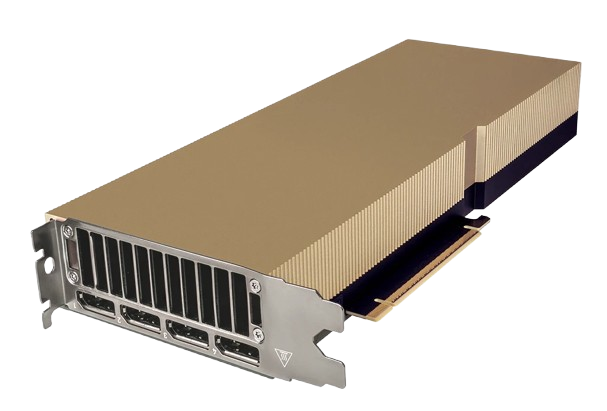

# GPU: NVIDIA RTX PRO 6000 Blackwell Server Edition

96 GB, passive (no fans of its own), dual slot, 267 mm long. Two per S2 (BOM item 5).
[Product page](https://www.nvidia.com/en-us/data-center/rtx-pro-6000-blackwell-server-edition/).

| File | What | Source |
|---|---|---|
| [nvidia-rtx-pro-6000-blackwell.png](nvidia-rtx-pro-6000-blackwell.png) | Product image | supplied by the team, 2026-10-26 |
